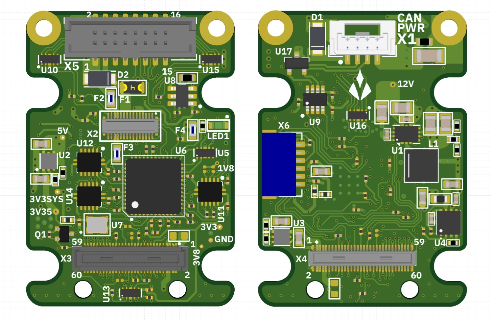
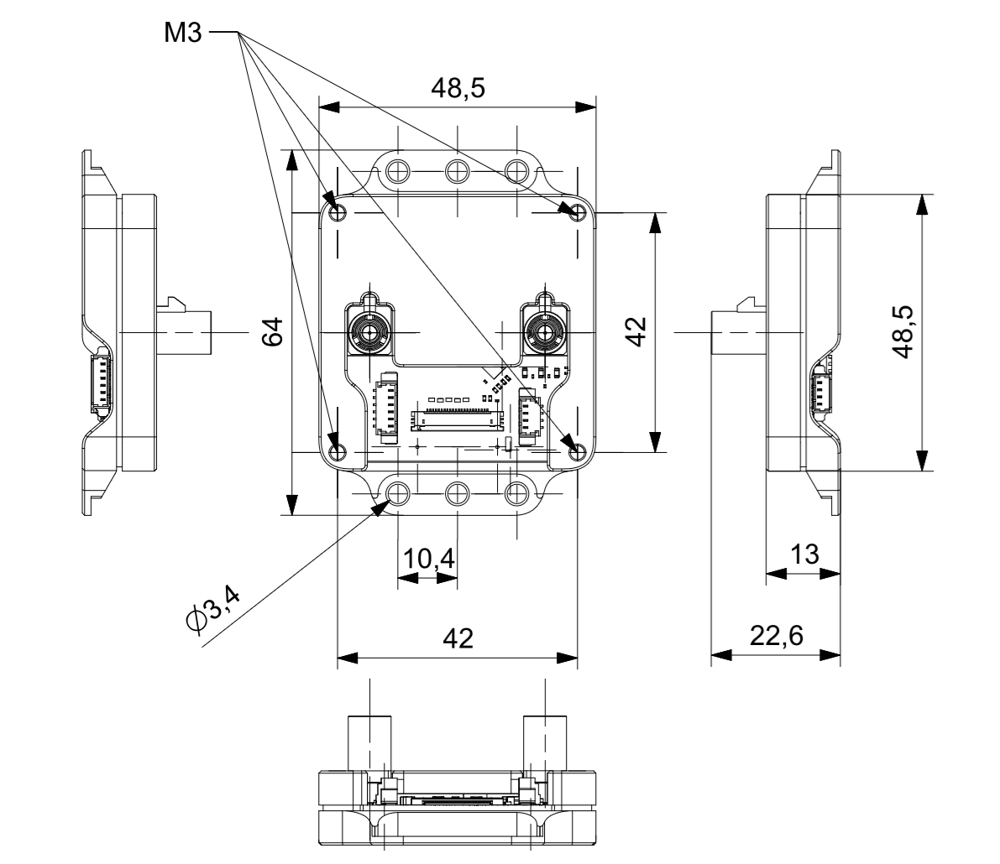

import { CardGrid, LinkCard } from '@astrojs/starlight/components';

	<section class="path-card">
		01 · Start
		<h2>Three commands to first contact</h2>
		
Install the host tool, wire a unit and confirm it answers with <code>nxs probe</code>, then upload a patch and stream SI samples. One wheel covers every transport.

		<a class="path-go" href="getting-started/install/">Install the host tool →</a>
	</section>
	<section class="path-card">
		02 · Guides
		<h2>The first hour with the hardware</h2>
		
From a fresh Jetson to a dual camera in seven chapters, one path each. Every step gives the command, the output it prints and what the output means.

		<a class="path-go" href="guides/">Open the guides →</a>
	</section>
	<section class="path-card">
		03 · Reference
		<h2>The released document set</h2>
		
Device reference, host interface, integration manual and patch authoring: the documents locked to the firmware that ships, mirrored here at each release.

		<a class="path-go" href="reference/">Browse the reference →</a>
	</section>

<section class="base">
	
01 / The hardwareTwo modules

	
The NXS module carries the sensor and the driver. The NXS Hub brings two GMSL camera links into a host over MIPI CSI-2.

	

		<article class="feature">
			<h3>Aliensense NXS</h3>
			Sensor co-processor · mikroBUS and MIPI · GMSL coax or CAN-FD
			

			

			
Connects mikroBUS Click sensors and MIPI cameras to a host over GMSL coax or CAN-FD. Patches are uploaded at run time and measurements arrive in SI units, self-described on the wire.

			
<a href="hardware/product-description/">Product description →</a><a href="hardware/datasheet/">Datasheet →</a>

		</article>
		<article class="feature">
			<h3>NXS Hub</h3>
			Camera interface · two GMSL inputs · MIPI CSI-2 out
			

			

			
Bridges two GMSL camera inputs into a host-friendly MIPI CSI-2 environment: deserialization, power management, control and protection in one module.

			
<a href="hub/product-description/">Product description →</a><a href="hub/datasheet/">Datasheet →</a>

		</article>
	

</section>

<section class="base">
	
02 / The documentation setFive sections

	<CardGrid>
		<LinkCard title="Getting started" href="getting-started/overview/">
			Install the host tool, probe the unit, upload a patch, stream SI
			samples.
		</LinkCard>
		<LinkCard title="Guides" href="guides/">
			From a fresh Jetson to a dual camera: seven chapters, one path
			each, every command with the output it prints.
		</LinkCard>
		<LinkCard title="NXS datasheet" href="hardware/datasheet/">
			Connectors, pinout, electrical ratings, and mechanical drawings.
		</LinkCard>
		<LinkCard title="NXS Hub datasheet" href="hub/datasheet/">
			Ratings, interfaces, connectors and pinouts, mechanical.
		</LinkCard>
		<LinkCard title="Reference" href="reference/">
			The released set: specifications and the integration
			documents.
		</LinkCard>
	</CardGrid>
</section>

	About Aliensense
	
Aliensense builds sensing infrastructure for robotics. The NXS platform moves the sensor-integration work (hardware interface, driver layer, data transport) onto the module itself, so sensors and cameras placed anywhere on a machine arrive at the compute node as decoded SI-unit data. This documentation set is published from the firmware repository at each release and matches the firmware it ships with.

